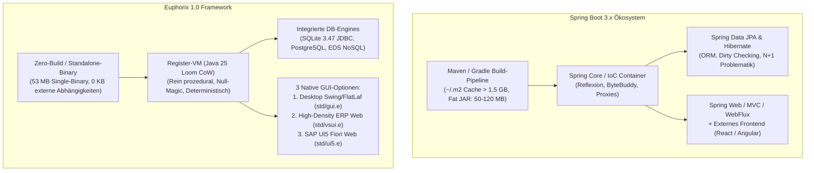
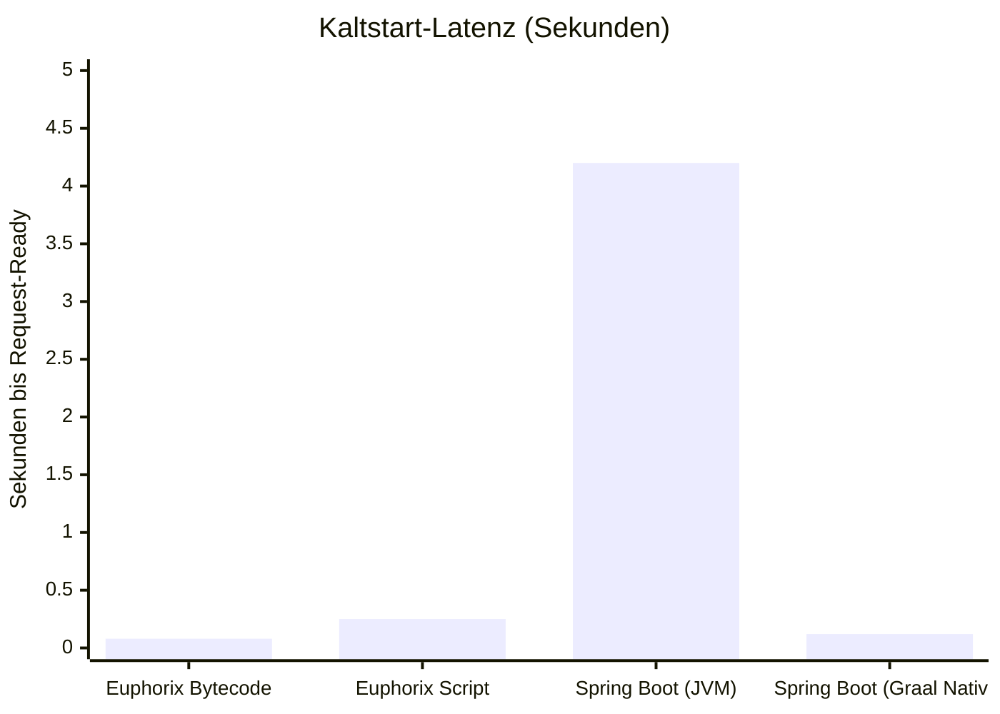
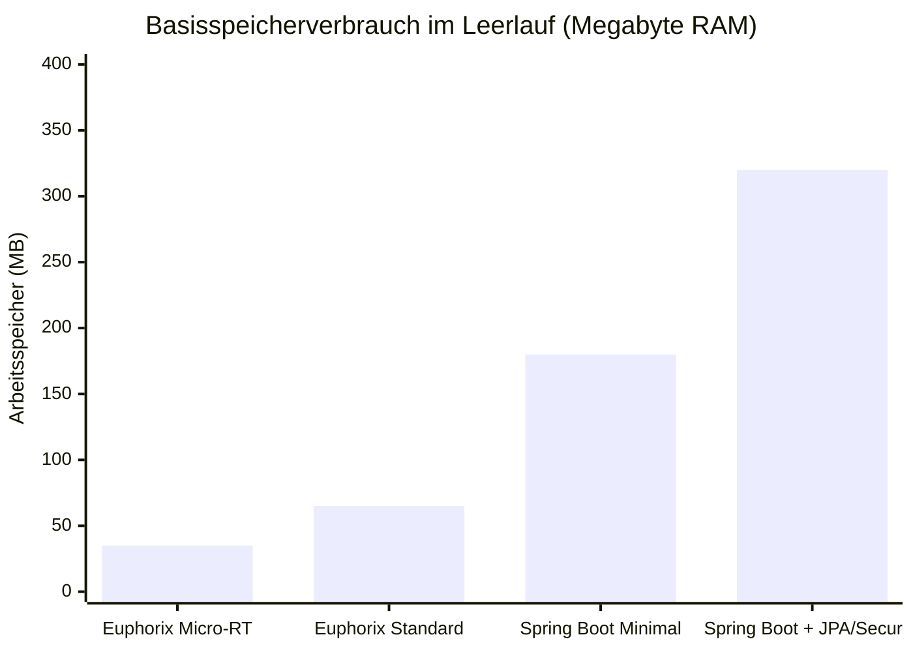
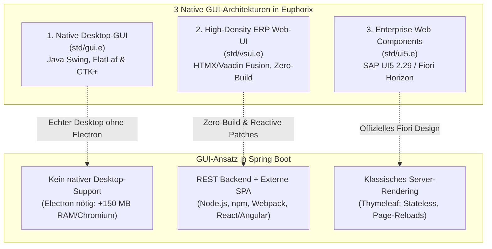
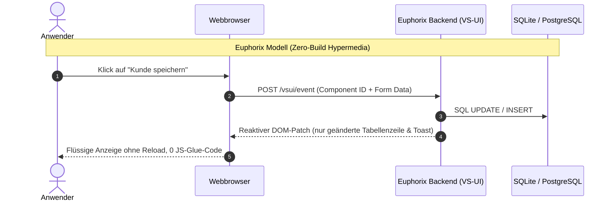
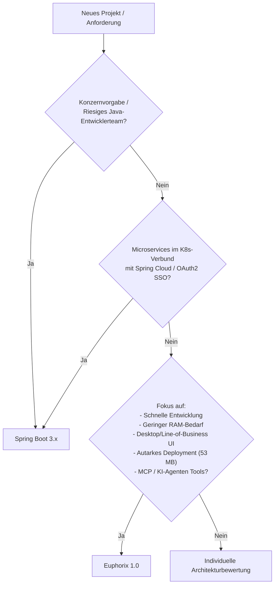

# Architektur- & Technologievergleich: Euphorix vs. Spring Boot

Dieses Dokument bietet einen fundierten, praxisnahen und umfassenden Vergleich zwischen der **Euphorix Enterprise VM & Standardbibliothek** und dem Industriestandard **Spring Boot** (Version 3.x auf Java 17/21/25).

Der Schwerpunkt liegt auf den Kernaspekten **Lernkurve**, **Größe des Frameworks (Footprint & Ressourcen)**, **Entwicklungsgeschwindigkeit**, **Architekturphilosophie** sowie typischen Einsatzfeldern.

---

---

## 1. Executive Summary & Kernphilosophie

| Dimension | Euphorix 1.0 | Spring Boot 3.x |
| :--- | :--- | :--- |
| **Primäres Paradigma** | Rein **prozedural**, datenorientiert, expliziter Kontrollfluss | **Objektorientiert**, deklarativ über Annotationen, Dependency Injection (IoC) |
| **Sprachbasis** | OpenEuphoria 4.x (Dynamic Sequences, 1-basiert) auf Java 25 VM | Java 17/21/25, Kotlin oder Groovy |
| **Execution Model** | Register-VM mit Copy-on-Write (CoW) oder AOT-Bytecode (`.exb`) | JVM HotSpot / C2 JIT-Compiler oder GraalVM AOT Native Image |
| **Philosophie** | *"Batteries Included, Zero-Magic, Minimal Friction"* | *"Convention over Configuration, Component Assembly"* |
| **Build-Zwang** | **Keiner** (Skripte sofort startbar; optional Bytecode-Kompilierung) | **Zwingend** (Maven/Gradle-Build, Annotation-Processing, Fat-JAR) |
| **Framework-Größe** | **53 MB** komplett autark (Standalone) oder **19 MB** JAR | **50 – 120 MB** pro Fat-JAR + **1 – 3 GB** lokaler Dependency-Cache |
| **Lernkurve** | **Sehr flach** (Produktiv nach 1–2 Tagen) | **Steil bis sehr steil** (Wochen bis Monate für das Gesamtökosystem) |
| **GUI-Ökosystem** | **3 integrierte Optionen:** 1. Native Desktop-GUI (Swing/FlatLaf) 2. High-Density ERP Web (VS-UI, Zero-Build) 3. SAP UI5 Fiori Enterprise Web | **Kein nativer Standard:** Headless REST + externes SPA-Frontend (React/Angular) oder veraltete SSR-Engines (Thymeleaf) |

---

## 2. Größe des Frameworks & Ressourcen-Footprint

Ein wesentliches Unterscheidungsmerkmal ist der Footprint auf Festplatte, im Arbeitsspeicher und in der Entwicklungs- bzw. Build-Infrastruktur.

### 2.1 Festplattenbedarf & Artefaktgrößen

* **Euphorix:**
  * **Standalone Single-Binary (`euphorix-standalone`):** Exakt **54,6 MB**. Beinhaltet die komplette Java 25 Runtime (stripped via `jlink`), die Register-VM, Compiler, SQLite 3.47 JDBC, PostgreSQL 42.7 JDBC, Swing/FlatLaf, Webserver, VS-UI Hypermedia und alle 49 Standardmodule. **Keine JDK-Installation auf dem Zielsystem erforderlich.**
  * **Kompakter Wrapper (`euphorix.jar`):** **19,5 MB** (wenn Java 25 auf dem Host vorhanden ist).
  * **Micro-Runtime (`runtime.jar` / `euphorix-rt`):** **19,0 MB** (ohne Compiler/Parser, rein für vorkompilierten Bytecode zum Schutz geistigen Eigentums).
  * **Projekt-Abhängigkeiten:** **0 MB**. Euphorix benötigt kein Verzeichnis wie `node_modules` oder `~/.m2/repository`. Alles ist in der Standardbibliothek enthalten.

* **Spring Boot:**
  * **Basis-Projekt (Fat-JAR):** Ein einfaches Spring-Boot-Projekt mit Spring Web, Spring Data JPA, Actuator und PostgreSQL-Treiber wiegt typischerweise **45 MB bis 90 MB**.
  * **Build-Cache (`~/.m2/repository`):** Durch transitive Abhängigkeiten (Tomcat/Netty, Jackson, Hibernate, ByteBuddy, Logback, Spring Framework, Micrometer usw.) belegt das Repository schnell **1,5 GB bis 5 GB** Speicherplatz.
  * **GraalVM Native Image:** Erzeugt zwar schlanke Binaries (~40–80 MB), erfordert jedoch langwierige Build-Zeiten (2–8 Minuten) und speicherintensive Compiler-Läufe (> 4–8 GB RAM beim Build).

### 2.2 Startup-Zeit & Speicherverbrauch (RAM)

> [!NOTE]
> Während eine typische Spring-Boot-Anwendung zur Laufzeit 200–500 MB RAM benötigt, um den ApplicationContext, Reflection-Metadaten und den JPA-Cache zu halten, arbeitet Euphorix dank seiner registerbasierten Architektur und Copy-on-Write-Sequenzen im Bereich von 35–80 MB RAM.

---

## 3. Die Lernkurve: Konzeptionelle Barrieren

Die Lernkurve unterscheidet sich fundamental durch die Menge an implizitem („Magie“) versus explizitem Wissen.

### 3.1 Die Euphorix-Lernkurve (Flach & Intuitiv)

OpenEuphoria und Euphorix wurden mit dem Ziel maximaler kognitiver Entlastung entworfen:

1. **Syntax in wenigen Stunden verstanden:**
   * Es gibt nur zwei elementare Datentypen: **Atome** (32/64-Bit Zahlen) und **Sequenzen** (beliebig tief verschachtelte dynamische Listen).
   * Keine Klassen-Hierarchien, keine Vererbungskonflikte, keine Interfaces, keine abstrakten Factories.
   * Prozeduren und Funktionen arbeiten direkt auf Datenstrukturen (`s = append(s, item)`).
2. **Keine versteckte Magie:**
   * Es gibt keine Bytecode-Modifikationen zur Laufzeit, keine versteckten Dynamic Proxies und keine Annotationen, die im Hintergrund das Verhalten ändern.
   * Was im Quellcode steht, wird von oben nach unten sequenziell ausgeführt.
3. **Batteries-Included Standardbibliothek:**
   * Anstatt Tage mit der Auswahl und Konfiguration von Maven-Paketen zu verbringen, sind SQLite (`std/sqlite.e`), PostgreSQL (`std/pgsql.e`), JSON/JSONPath (`std/json.e`), HTTP (`std/http.e`), GUI (`std/gui.e`) und KI (`std/mcp.e`, `std/llm.e`) standardisiert und mit identischen Mustern dokumentiert.

### 3.2 Die Spring-Boot-Lernkurve (Steil & Vielschichtig)

Spring Boot abstrahiert enorme Komplexität durch **Convention over Configuration**. Dies erleichtert Standardfälle, erzeugt aber eine hohe Einstiegs- und Fehlerhürde:

1. **Das Annotations-Labyrinth:**
   * Ein Entwickler muss Dutzende Annotationen und deren Interaktion verinnerlichen: `@SpringBootApplication`, `@Component`, `@Service`, `@Repository`, `@Autowired`, `@Qualifier`, `@Scope`, `@Configuration`, `@Bean`, `@Value`.
   * Versteckte Fallstricke: Ein `@Transactional` auf einer `private` Methode oder der interne Selbstaufruf einer Methode derselben Klasse umgeht den AOP-Proxy geräuschlos – Transaktionen greifen plötzlich nicht, ohne dass ein Compiler-Fehler auftritt.
2. **JPA & Hibernate (Objekt-Relationales Impedanz-Mismatch):**
   * Das Verstehen von Entity-Lifecycles (*transient*, *persistent*, *detached*, *removed*), Lazy Loading, `LazyInitializationException`, Dirty Checking und dem berüchtigten **N+1 Query-Problem** erfordert tiefes Spezialwissen.
3. **Build- und Toolchain-Komplexität:**
   * Beherrschung von Maven/Gradle, Multi-Module-Projekten, BOM-Imports, Dependency-Version-Alignments und Profilen (`application-dev.yml` vs. `application-prod.yml`).
4. **Fehlersuche & Stacktraces:**
   * Ein Laufzeitfehler in Spring Boot erzeugt oft Stacktraces mit 60 bis 120 Zeilen, die tief durch CGLIB-Proxies, Reflection-Aufrufe und Filterketten (`FilterChainProxy`, `DispatcherServlet`) führen, bevor die eigentliche Entwicklerzeile sichtbar wird.

---

## 4. Die drei GUI-Möglichkeiten von Euphorix im Vergleich zu Spring Boot

Einer der markantesten Unterschiede zwischen beiden Ökosystemen ist die Benutzeroberflächen-Strategie. Während Spring Boot fast ausschließlich als Headless-Backend konzipiert ist und Benutzeroberflächen an externe Ökosysteme auslagert, liefert Euphorix **drei vollständig integrierte GUI-Paradigmen** direkt in der Standardbibliothek mit:

---

### 4.1 Möglichkeit 1: Native Desktop-GUI mit Swing & FlatLaf (`std/gui.e`)

Für vollwertige Desktop-Anwendungen auf Linux (X11/Wayland) und Windows bietet Euphorix mit `std/gui.e` ein deklaratives, direktes Desktop-Toolkit:

* **Echter nativer Desktop ohne Electron-Bloat:**
  * Moderne Desktop-Apps werden heute oft mit Electron gebaut, was pro App eine komplette Chromium-Instanz und Node.js mitschleppt (mindestens 150–300 MB RAM und 100+ MB Binärgröße).
  * Euphorix nutzt das in der VM integrierte Java Swing & FlatLaf mit nativer **GTK+-, Nord- und Dark-Theme-Unterstützung**, Subpixel-LCD-Antialiasing und Ubuntu/Segoe-UI-Systemschriftarten.
* **Deklarative Programmierung & Ereignisse:**
  * Fenster (`gui:window`), Buttons, strukturierte Formulare, Tabellen, Scrollbereiche, Menüs, Fortschrittsbalken und native System-Dateidialoge (`gui:file_dialog`).
  * Ereignisbehandlung erfolgt direkt über OpenEuphoria Routine-IDs (`gui:on_click(btn, routine_id("on_submit"))`), ohne anonyme Listener-Klassen oder Threads synchronisieren zu müssen.
* **Vergleich zu Spring Boot:**
  * Spring Boot besitzt **keine offizielle Desktop-Unterstützung**. Wer versucht, Spring Boot mit Desktop-Frameworks (JavaFX oder Swing) zu verheiraten, kämpft mit kollidierenden Lifecycle-Managern, Thread-Sicherheitsfallen zwischen dem AWT Event Dispatch Thread (EDT) und dem Spring-Context sowie massiven Kaltstartverzögerungen.

---

### 4.2 Möglichkeit 2: High-Density ERP Web-UI (`std/vsui.e`) — HTMX & Vaadin Fusion

Für datenintensive Geschäftsanwendungen, Leitstände, ERP- und Warenwirtschaftssysteme im Webbrowser wurde die **VS-UI Suite** entwickelt:

* **Zero-Build & 100% Autark:**
  * Keine Node.js-, npm- oder Webpack/Vite-Buildschritte.
  * Keine externen CDN-Abhängigkeiten – alle Styles und ES6-Module liegen lokal in `./html/` und sind für DSGVO-Konformität und Offline-Einsatz optimiert.
* **22 High-Density Enterprise-Komponenten:**
  * **DataGrid (`vsgrid`):** Sticky Headers, blitzschnelle Client-Volltextsuche und automatische Umschaltung in eine mobile Card-Ansicht auf Smartphones.
  * **Kaufmännische Präzision:** Spezialisierte Zahlenfelder (`vsnuminput`) mit DIN 5008 Formatierung (deutsche Tausendertrennung, feste Nachkommastellen `50.000,00 €`), automatischer Formatierung bei Fokusverlust und pixelgenauen Layout-Koordinaten (`opt_xywh`).
  * **Modals, Splitters, Tabs, Collapsibles & Drag-and-Drop Datei-Uploads.**
* **Reaktive DOM-Patches:**
  * Ähnlich wie bei HTMX oder Phoenix LiveView schickt das Backend nach Aktionen nur gezielte Delta-Patches (`vsui:updates({ vsui:set_val("kdnr", "10043"), vsui:toast_show("Gespeichert!") })`), die der Browser flimmerfrei in das DOM einsetzt.
* **Vergleich zu Spring Boot:**
  * In Spring Boot muss für eine vergleichbare Anwendung ein separates Frontend-Projekt (React, Angular oder Vue) aufgesetzt, gepflegt und synchronisiert werden. Es entstehen doppelte Datenmodelle (Java DTOs vs. TypeScript Interfaces) und ein massiver Wartungsaufwand für API-Änderungen.

---

### 4.3 Möglichkeit 3: Enterprise Web Components Suite (`std/ui5.e`) — SAP Fiori Horizon

Wenn Anwendungen standardkonforme Großkonzern-Ästhetik und zertifizierte Barrierefreiheit verlangen, stellt Euphorix mit `std/ui5.e` eine vollständige Integration der **SAP UI5 Web Components 2.29** bereit:

* **Offizielles Fiori Horizon Design:**
  * 65 High-Level-Routinen für alle SAP Fiori UI-Elemente: `shellbar` (mit Avatar und Profilmenü), `card`, `table_from_query` (erzeugt fertige Tabellen direkt aus SQL-Queries), `timeline`, `illustrated_message` (leere Statusseiten mit Vektorgrafiken), `daterange_picker`, `rating_indicator`, `segmented_button` u. v. m.
* **Integrierter Anwendungs- & Routing-Server:**
  * Mit `ui5:app()` und `ui5:page_route()` wird die gesamte Single-Page-Application inklusive URL-Navigation serverseitig in OpenEuphoria definiert.
  * Barrierefreiheit nach **WCAG 2.1 AA** ist von Haus aus durch die SAP-Basis garantiert.
* **Vergleich zu Spring Boot:**
  * Spring Boot bietet von Haus aus keinerlei UI5-Unterstützung. Enterprise-Entwickler müssen UI5-Libraries mühsam über npm in Webpack einbinden oder auf ältere OpenUI5-Java-Adapter zurückgreifen.

---

### Zusammenfassung der GUI-Möglichkeiten

| Kriterium | Euphorix Desktop (`std/gui.e`) | Euphorix ERP Web (`std/vsui.e`) | Euphorix SAP Web (`std/ui5.e`) | Spring Boot Standard |
| :--- | :--- | :--- | :--- | :--- |
| **Zielplattform** | Nativer Desktop (Linux / Win) | Webbrowser (Desktop & Mobil) | Webbrowser (Enterprise) | Nur Headless REST / GraphQL |
| **Design-Sprache** | FlatLaf / GTK+ / Nord | High-Density ERP / DIN 5008 | SAP Fiori Horizon | Kein Standard (vom Frontend bestimmt) |
| **Frontend-Buildstep** | **Keiner** | **Keiner (Zero-Build)** | **Keiner (Zero-Build)** | Zwingend Node.js, npm, Vite/Webpack |
| **Programmiersprache** | 100% OpenEuphoria | 100% OpenEuphoria | 100% OpenEuphoria | Java (Backend) + TypeScript (Frontend) |
| **Client-Footprint** | 0 MB (nutzt VM) | Sehr gering (Vanilla CSS/JS) | Gering (Web Components) | Hoch (1–5 MB JS-Bundle im Browser) |

---

## 5. Moderne Enterprise-Funktionen: KI, Agenten & Concurrency

| Bereich | Euphorix 1.0 | Spring Boot 3.x |
| :--- | :--- | :--- |
| **KI-Agenten & MCP** | **Nativ eingebaut** (`std/mcp.e`): Voller MCP Server & Client (Model Context Protocol via Stdio JSON-RPC). Sofort einsatzbereit für Claude Desktop, Cursor und Agenten. | Kein nativer Kernstandard. Muss manuell implementiert oder über externe Community-Bibliotheken angebunden werden. |
| **LLM & RAG** | **Nativ eingebaut** (`std/llm.e`, `std/rag.e`): Direkte Ollama/OpenAI Inferenz und Vektor-RAG im Speicher. | Über **Spring AI** (separates, relativ neues Modul) mit solider OpenAI/Ollama-Anbindung. |
| **Parallelität** | **Java 25 Loom Virtual Threads** (`thread:spawn`, `thread:async`, `thread:await`) + **Go-Style CSP Channels** (`std/channel.e`). | ThreadPools oder Java 21+ Virtual Threads über `@Async` / Tomcat Virtual Thread Executor, WebFlux (Projekt Reactor / Netty). |
| **Quellcode-Schutz** | **AOT-Bytecode (`.exb`) + Stripped Micro-Runtime**: Auslieferung ohne Quellcode und ohne Compiler möglich. | Java-Bytecode (`.class`) in JARs ist trivial dekompilierbar (CFR, Procyon). Benötigt ProGuard / Allatori Obfuskation. |
| **IDE-Support** | Eingebauter **LSP 3.17 Server** (`euphorix --lsp`) für NetBeans & VS Code. | Perfekte IDE-Integration in IntelliJ IDEA (Ultimate), Eclipse und VS Code. |

---

## 6. Wann setzt man was ein? (Entscheidungsmatrix)

### Wann Spring Boot die überlegene Wahl ist:
1. **Riesige Entwicklerteams & Arbeitsmarkt:** Zugriff auf hunderttausende erfahrene Java-Entwickler weltweit.
2. **Konzern-Infrastrukturen:** Tief verankerte Systeme mit Spring Cloud, Eureka, Netflix Conductor, Kafka-Streams und komplexem Keycloak/OAuth2-SSO.
3. **Reine Backend-APIs im Megamassstab:** Wenn Hunderte Microservices von spezialisierten Teams betreut werden und Frontend-Teams unabhängig in React arbeiten.

### Wann Euphorix die überlegene Wahl ist:
1. **Hohe Agilität & kleine bis mittlere Teams:** Anwendungen können von einem einzelnen Entwickler in einem Bruchteil der Zeit fertiggestellt werden, da keine Schichten-Bürokratie existiert.
2. **Desktop-, Edge- & On-Premises-Auslieferung:** Das 53-MB-Single-Binary läuft auf jedem Linux- oder Windows-Rechner ohne Installation von Java oder Abhängigkeiten.
3. **Flexible Benutzeroberflächen ohne Schichtenbruch:** Egal ob nativer Desktop (`std/gui.e` mit Swing/FlatLaf ohne Electron-Ballast), dichte kaufmännische Web-Apps (`std/vsui.e` mit DIN 5008 und reaktiven Patches) oder barrierefreie Enterprise-Portale (`std/ui5.e` mit SAP Fiori) – alles wird deklarativ und konsistent in OpenEuphoria entwickelt.
4. **Schutz geistigen Eigentums:** Vorkompilierte `.exb`-Bytecode-Dateien auf einer schlanken Runtime verhindern, dass Kunden oder Dritte den Quellcode einsehen.
5. **KI- und Agenten-Werkzeuge:** Wenn Sie spezialisierte Werkzeuge (Tools) für autonome LLMs oder Desktop-Assistenten (Claude, Cursor) via MCP schreiben möchten.

---

> [!TIP]
> **Fazit:** Euphorix ist nicht angetreten, um Spring Boot in riesigen Java-Konzernabteilungen mit 50 Entwicklern abzulösen. Stattdessen positioniert sich Euphorix als **extrem schlagkräftige, leichtgewichtige und wartungsarme Alternative** für Entwickler, die den Ballast moderner Frameworks (Build-Dauer, Gigabyte-Abhängigkeiten, Annotations-Magie, Frontend-Framework-Churn) hinter sich lassen wollen.
